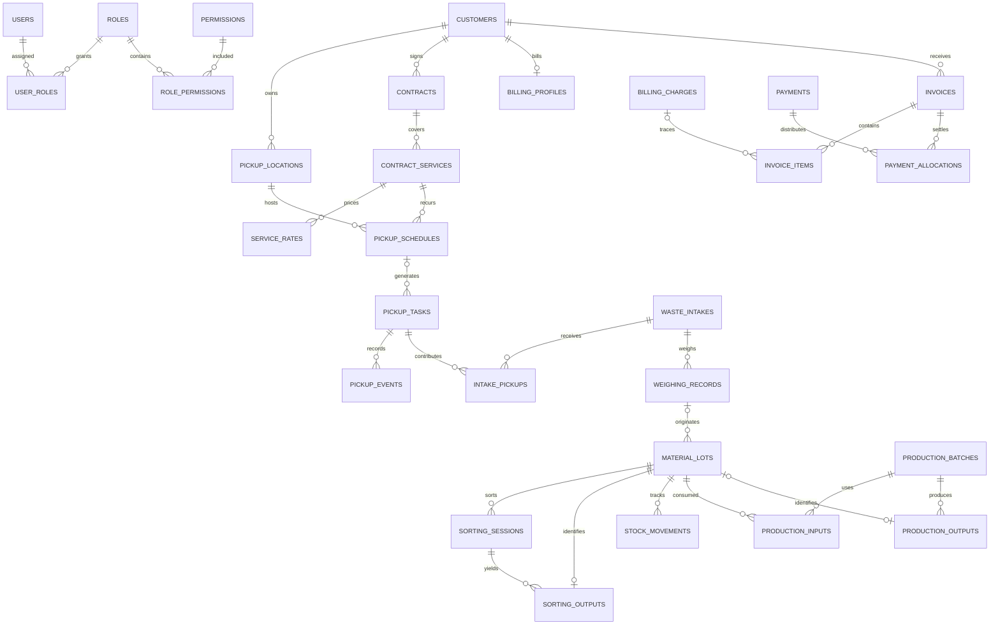

# PostgreSQL design and ERD

This is the logical migration design. Entity names below are proposed table names. Every entity and junction has a UUID primary key plus natural-key uniqueness where needed. Use explicit foreign keys with restrictive deletion for operational history. Dates use `date` for Jakarta business days. Use `timestamptz` for instants, `numeric(16,3)` for kg, `numeric(20,6)` for unit rates and `numeric(20,2)` for posted IDR amounts. Persist compatible decimal precision in the API and reject values outside the column range before writing. IDs in this document use the corresponding resource name with an `_id` suffix.

## Phase 1 schema

The identity migration creates `users`, `roles`, `permissions`, `user_roles` and `role_permissions`. Users have a unique normalized email, a hashed password and a session version used for revocation. The infrastructure migration creates `audit_logs`, `reference_values` and `failed_jobs`. PostgreSQL rejects update, delete and truncate operations on the audit table. Audit events for account changes use the same transaction as the account and role grants.

The standard seeder sets the eight-role catalog and the IDR, kg and Asia/Jakarta defaults. It preserves existing user grants. The local-only demo command provisions synthetic users from environment-supplied credentials. Sessions and job queues are stored in Redis. The remaining entities and relationships below describe later phases.

## Phase 2 schema

The customer and contract migration adds customer categories, profiles, contacts, pickup locations, contracts, status events, services, rates and weekly schedules. A composite foreign key ties a service to a location under the same customer as its contract. The schedule references that service and derives its location through the relationship. Billing profiles have one row per customer. Rate amounts use `numeric(20,6)` and remain decimal strings in the API. Contract status events are append-only, with a PostgreSQL guard against update, delete and truncate.

`btree_gist` supports exclusion constraints on effective ranges. A service can have only one rate on a date and one schedule for a weekday and time within an overlapping range. The existing database role can install this trusted extension when it owns the database. Managed environments can provision it before migration. Customer status, contract transitions and dependent writes lock customers before contracts. Contract status and audit events are written in the same transaction as the transition.

## Phase 3 schema

The collection migration adds vehicles, pickup tasks, append-only pickup events, staged and linked evidence, and field weight entries. Tasks preserve a pickup location snapshot with an ownership foreign key. Generated tasks have a unique schedule series, date and time. Manual task IDs come from the submitting client. Each state transition increments its task revision and adds one history row with a unique sequence. Capture and receive times are tracked separately. Event UUIDs and request hashes make repeated sync idempotent.

Evidence belongs to a task and uploader before an accepted event links it. The database records an object key and digest, while sanitized JPEGs live on the private local storage disk. Completion weights store kg and an `estimated` or `field_measured` basis. Facility verification follows in Phase 4.

## Entities, keys and indexes

| Domain | Schema and relationships |
|---|---|
| Identity | `users` has normalized unique email, password hash and active flag. `roles` and `permissions` have unique codes. `user_roles` and `role_permissions` have unique FK pairs, indexed in both directions. Retain user attribution after deactivation. |
| Customers | `customer_categories` has stable unique code. `customers` has category, code, name and lifecycle. `customer_contacts` and `pickup_locations` reference customer. Locations store address and optional coordinates. `billing_profiles` has unique customer FK, billing identity, address, contact and agreed payment terms. Search normalized names and index category/status. |
| Contracts | `contracts` references customer and has business code and service dates. `contract_status_events` stores actor, prior/next status, time and reason. `contract_services` references contract and service location. `service_rates` stores pricing model, unit rate, tax policy reference and effective date range. Use an exclusion constraint per service for overlapping effective ranges, with `btree_gist` provisioned in migration. `pickup_schedules` references service and its location, with recurrence weekday, slot, effective range and a stable series UUID retained across schedule revisions. |
| Collections | `vehicles` has unique registration and active status. `pickup_tasks` references location, optional contract service and schedule revision, nullable driver and vehicle, Jakarta service date, slot, status and revision. Unique generated occurrence on series UUID, service date and slot. Use a scheduled-date/status index and driver/date index. `pickup_events` is append-only with globally unique client UUID, immutable request hash, task, actor, server sequence unique per task, captured and received instants, and GPS. `pickup_evidence` links accepted files to events. `pickup_waste_entries` associates captured kg and basis with the task event, plus optional classification. |
| Waste intake | `waste_types` has unique code, display name and active flag. `waste_intakes` stores receipt code, intake date, vehicle and state. `intake_pickups` has a unique intake/pickup pair and reverse index, with optional independently evidenced verified kg. `weighing_records` has calculated or direct net, actor, method, unit and supersession/reversal references. Use a one-current-posted-weighing invariant per intake and preserve prior records. |
| Materials | `material_lots` has lot code, waste type or product, originating weighing or other lineage, basis, available and quarantined balances and receipt date. Enforce nonnegative balances and index by type/product and availability. `sorting_sessions` references source lot, input, loss, variance, tolerance snapshot and reviewer. `sorting_outputs` associates classified and residual lots with the session. `stock_movements` links lot and a typed source transaction ID using explicit source references, signed delta per stock bucket, posting instant and optional unique original movement reversal reference. Index lot/posting order. |
| Production | `products` has unique SKU and mass basis. `process_measurement_templates` versions process, measure, unit and validation. `production_batches` has unique code, process, state, basis and timestamps. `production_inputs` holds source lot, intended and consumed quantities, and ingredient category. External ingredients enter as traceable lots. `material_eligibility_approvals` has lot, intended use, evidence, validity and approver. `production_measurements` references batch and template version. `production_outputs` ties product, basis and quantity to output lot. `production_losses` records amounts and reason. `production_qc_decisions` stores reviewer, outcome, evidence and timestamp. |
| Billing | `billing_runs` has kind, period, retry status and a unique caller request key. `billing_charges` has unique service + occurrence kind + occurrence key for monthly period, pickup UUID or one-time occurrence. `invoices` references customer, optional run and superseded invoice, with unique allocated number, snapshot identity, dates, currency, totals and state. `invoice_items` references invoice and optional charge, with rate, description, quantity, tax inputs and rounded totals. A charge stores its current invoice item reference, updated only during issue/correction under lock. Use `invoice_number_sequences` for atomic numbering by configured series and `invoice_correction_requests` for maker/checker and reason. `tax_policies` stores effective dated configuration. |
| Payments and expenses | `payments` references customer, amount, date, method and verifier. `payment_allocations` links payment and invoice with unique pair and positive allocation amount. `payment_reversals` references verified payment uniquely, with independent approval and reason. Persist external reference when supplied and index it by method. `expenses` stores operational category, date, amount, payee, optional file and recorder. Index invoices by customer/date and payments and expenses by posting date. |
| Shared infrastructure | `files` stores private object key, hash, bytes, detected MIME, uploader, state and task binding for evidence. `audit_logs` append actor, action, resource, reason, correlation and redacted detail. `idempotency_keys` uniquely scopes actor, operation and key, with normalized payload hash and result metadata. `outbox_messages` holds stable job key, payload, attempt and delivery metadata. |

## Posting and reconciliation

Use composite references or transactional validation for same-customer location, service, task and invoice relationships. Back this with cross-customer denial tests. Intake corrections and sorting reversals retain immutable request and approval records via `intake_correction_requests` and `sorting_reversal_requests`. Store old and proposed values, independent reviewer, decision and reason. `pickup_weight_verifications` references pickup, finalized attributable kg and the exact underlying intake allocations through `pickup_weight_verification_sources`. Retain superseded versions. Invoice items retain the selected verification reference for kg-based charges.

- Intake posting locks its draft, validates either gross ≥ tare ≥ 0 or a direct net value, then creates a classified lot and inbound movement atomically. Supporting multiple classifications may use sorting. Attribution is nullable at intake/pickup level, requires evidence and may never exceed the verified intake total in aggregate. A pickup can appear in several intakes. Billable pickup mass remains unavailable until authorized attribution is finalized across linked loads. Prevent duplicate billable allocation and surface disputed attribution for finance review.
- Stock mutations lock affected lots in sorted UUID order and append movement and audit records in the same transaction as updating balances. Reconcile balance projections against ledger sums. QC transfers quantity from quarantined to available atomically. A reversal checks dependencies and balances, documents reason and references original movements. Reject reversals with consumed descendants until downstream changes have been resolved. A correction posts a replacement transaction where applicable.
- Invoice issue locks the invoice, number sequence and affected charges, checks current claims, and publishes a PDF job with the immutable snapshot. Payment verification locks its payment and affected invoices in stable order, requires allocation total equal to receipt amount for the initial release, enforces per-invoice outstanding, and records audit with balance updates. A separate reversal row and audit event restore invoice balances. Void/reissue is allowed only after conflicting verified payments are reversed.
- Persist half-open effective ranges. Define whether user-entered ends are inclusive at input conversion. Store sorted or produced mass on its measured basis. Pair quarantined and available deltas on each stock transfer and enforce that their sum is zero for a release. Use a decimal library or PostgreSQL exact arithmetic for financial calculations. Store tax basis and rounding configuration in each issued snapshot and sum rounded line totals. Finance must confirm the rounding stage before enabling issue.
- Favor forward, additive migrations and explicit backfills before constraints. Use production migrations separately from idempotent seeders for permissions and other approved configuration. Use synthetic factories in CI only. Phase 1 proves clean migrations and repeatable seeding. Later phases add only the tables they exercise.
